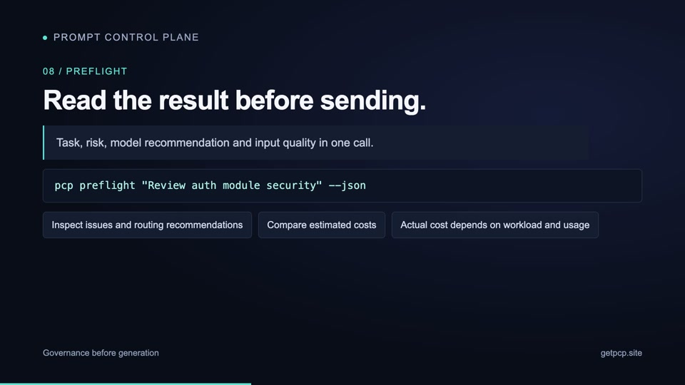
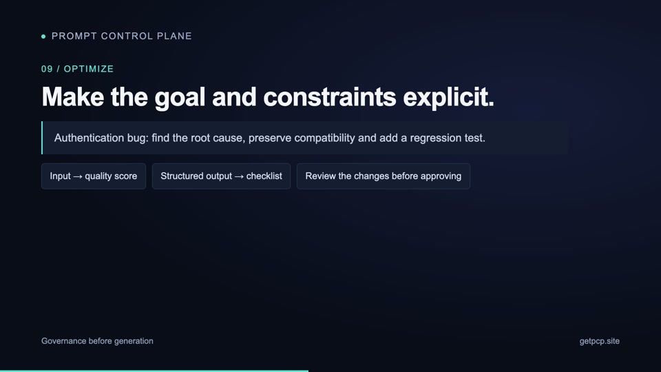
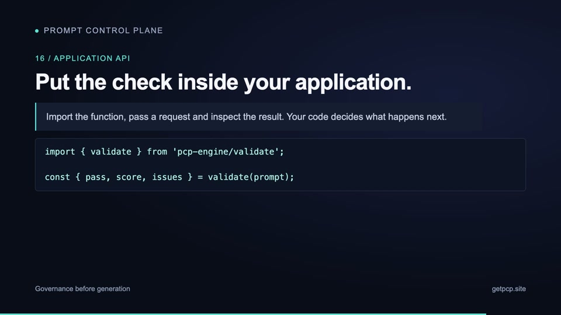
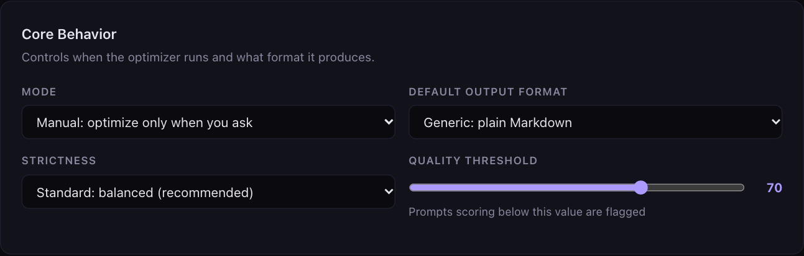
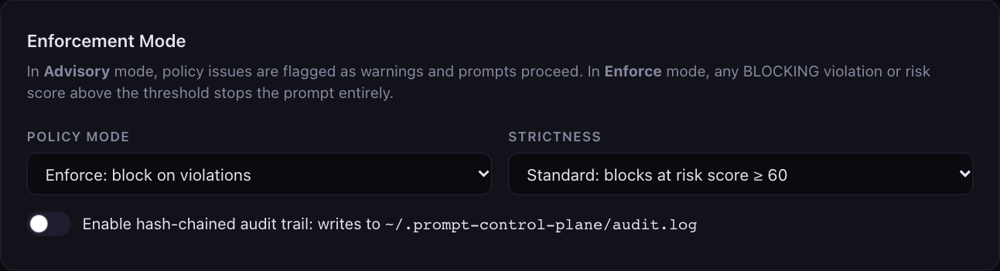
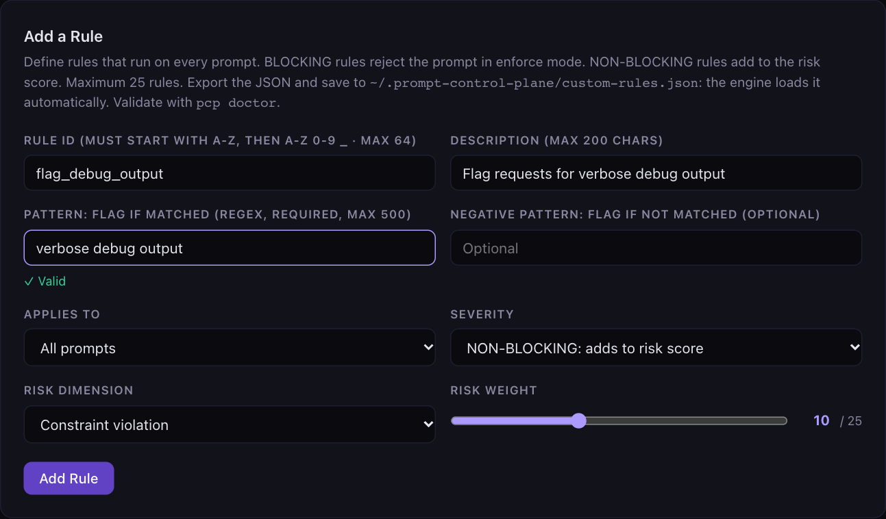

# Prompt Control Plane

Prompt Control Plane governs prompts before they reach a model. Its deterministic engine analyzes and scores requests, applies configured policy, and can compile a structured prompt for review, without making LLM calls. Apache-2.0.

Core analysis and generic compilation are model-agnostic. Provider-specific compilation targets, routing, and cost estimates depend on supported targets and a maintained catalog. PCP does not evaluate model outputs.

## Five-minute walkthrough

Follow a prompt from its first quality check to a compiled request, then see how to use the same checks in an application.

https://github.com/user-attachments/assets/e2699dbf-284d-4430-ae4f-3aec9842e6f5

[Watch the original with English captions](https://getpcp.site/#video) · [Download the original MP4](https://raw.githubusercontent.com/rishi-banerjee1/prompt-control-plane/main/assets/pcp-styled-v2.mp4)

<details>
<summary>Three moments from the walkthrough</summary>

**1:50 · Inspect a request.** Use `pcp preflight` to review input quality, risk, and the routing recommendation.



**2:20 · Refine the prompt.** The authentication example makes the goal, compatibility constraint, and regression test explicit.



**4:20 · Apply a check in your app.** Import `validate` to get a pass flag, score, and issues before deciding whether to send the prompt.



</details>

## Inside the governance console

| Optimizer settings | Policy enforcement | Custom rule editor |
| --- | --- | --- |
| [](assets/console/optimizer.png) | [](assets/console/policy.png) | [](assets/console/rule-editor.png) |
| Choose an output format and quality threshold. | Set when a policy violation blocks approval. | Define a pattern, its severity, and its risk weight. |

Select a screenshot to enlarge it, or [try the governance console](https://getpcp.site/admin).

## Install

Requires Node.js 20 or later.

```sh
npm install -g https://github.com/rishi-banerjee1/prompt-control-plane/releases/download/v5.4.3/pcp-engine-5.4.3.tgz
pcp optimize "Review the auth module and preserve its public API." --json
```

For a prompt stored in your repository, run `pcp optimize --file prompts/review-auth.md --json`.

The GitHub release is Apache-2.0. The npm update to 5.4 is coming soon; the latest npm release is 5.3.3. Check the [getpcp.site changelog](https://getpcp.site/changelog.html) or [GitHub Releases](https://github.com/rishi-banerjee1/prompt-control-plane/releases) for version updates.

## Use the GitHub Action

```yaml
- uses: rishi-banerjee1/prompt-control-plane@v5.4.3
  with:
    subcommand: optimize
    files: "prompts/review-auth.md"
```

This runs PCP’s full prompt analysis and compilation pipeline, applies configured policy, and returns score, risk, and recommended changes. Use check with a threshold when CI needs a pass/fail gate across prompt files; use preflight for a compact score, risk, and routing summary.

See [`action.yml`](action.yml) for every input and output.

## Use PCP as an MCP server

The MCP server exposes deterministic analysis, policy, compilation, and audit tools. PCP is active in the [official MCP Registry](https://registry.modelcontextprotocol.io/v0.1/servers/io.github.rishi-banerjee1%2Fpcp-engine/versions/latest). Its request to join the [GitHub MCP Registry](https://github.com/github/github-mcp-server/discussions/3934) is awaiting initial manual curation, so PCP is not searchable in GitHub’s registry yet. The release workflow publishes each new MCPB version to the official Registry automatically; GitHub can sync future versions after initial curation.

## Use the TypeScript API

```ts
import { analyzePrompt, scorePrompt } from "pcp-engine";

const intent = analyzePrompt("Review the auth module and preserve its public API.");
const score = scorePrompt(intent);
console.log(score.total);
```

## Develop

```sh
npm ci
npm run build
npm test
npm audit --audit-level=moderate
```

- [Developer reference](https://getpcp.site/docs) for CLI commands, MCP client setup, GitHub Actions, and the Node.js API.
- Security reports: [Security advisories](https://github.com/rishi-banerjee1/prompt-control-plane/security/advisories)
- License: [Apache-2.0](LICENSE)
